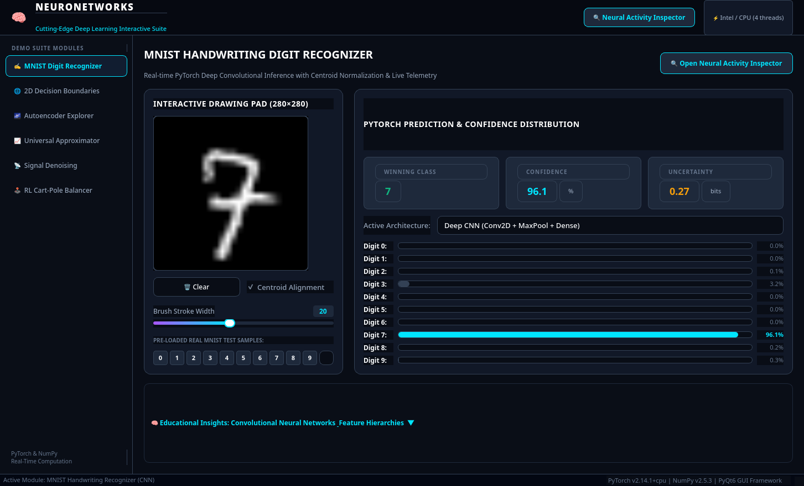
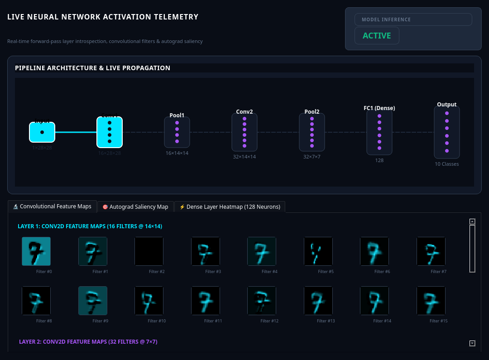
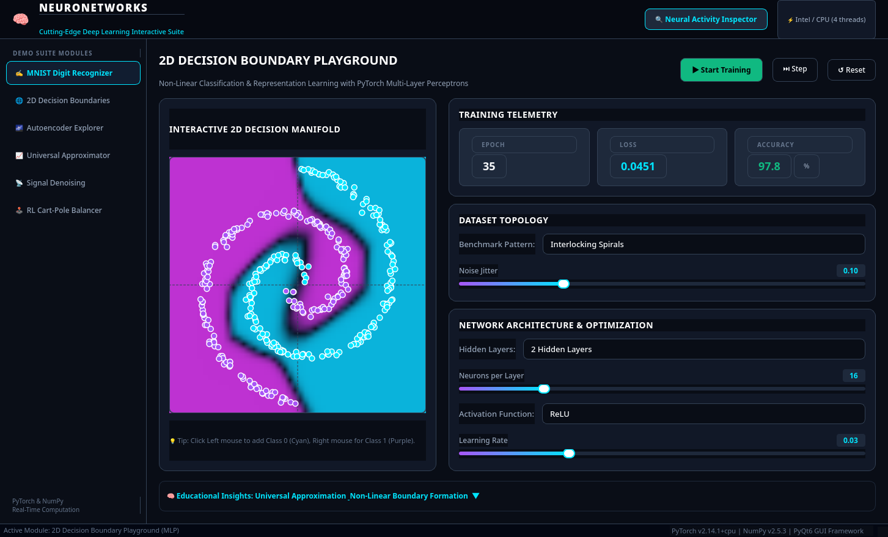
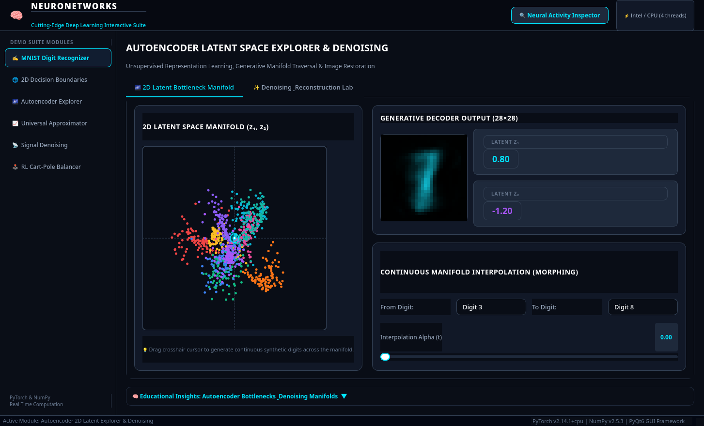
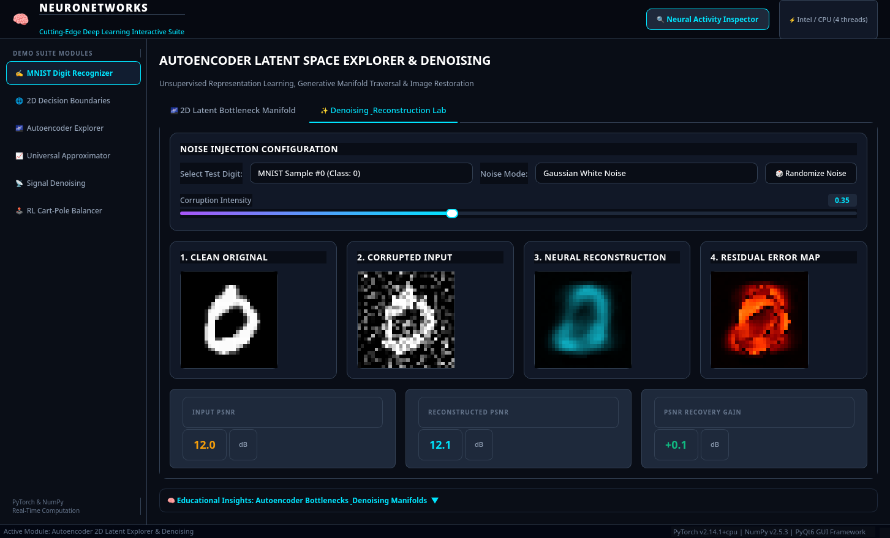
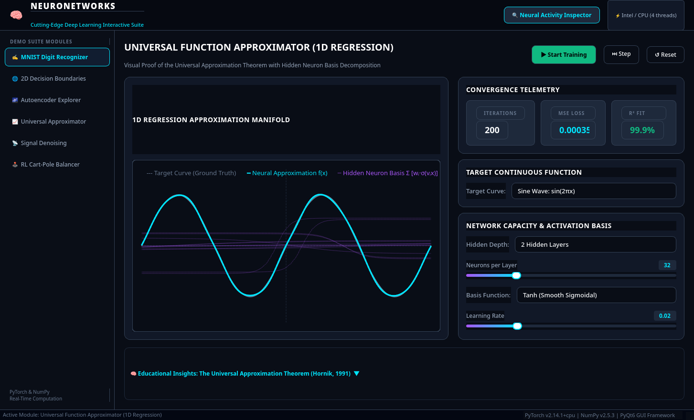
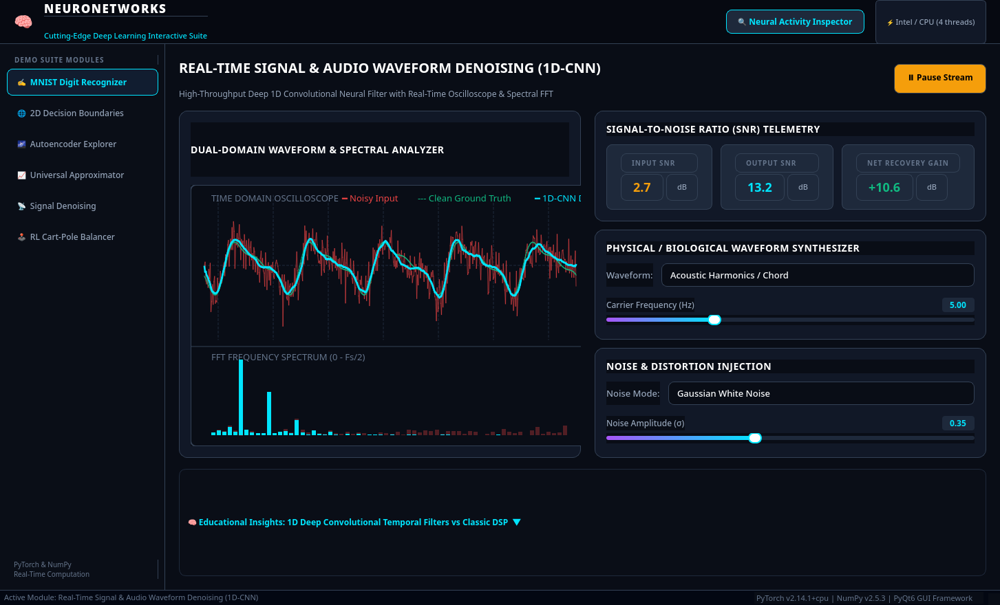
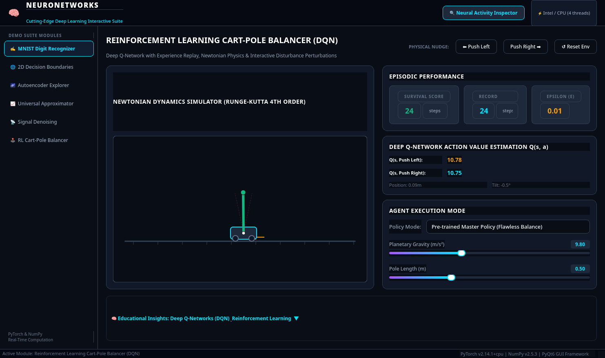

# 🧠 NeuroNetWorks: Deep Learning Interactive Educational Suite

**NeuroNetWorks** is a cutting-edge, high-performance desktop application built with **PyTorch**, **NumPy**, and **PyQt6**. It features a modern Cyber-Lab visual interface, real-time PyTorch tensor computations, and an educational suite where each module showcases a distinct neural network architecture, learning paradigm, and practical capability.

---

## 📚 Complete Learning Guides & Documentation

To transform this repository into an educational tool for machine learning and deep learning, consult our dedicated manuals:

* 📖 **[User Manual (USER_MANUAL.md)](file:///home/cyrus/Projects/Python_AI/NeuroNetWorks/USER_MANUAL.md):** Complete guide to operating the desktop application, navigating canvases, understanding interactive controls, using the Auxiliary Neural Inspector, and running hands-on self-study experiments for every module.
* 🔬 **[Technical Architecture & Math Reference (TECHNICAL_DOCUMENTATION.md)](file:///home/cyrus/Projects/Python_AI/NeuroNetWorks/TECHNICAL_DOCUMENTATION.md):** In-depth technical breakdown of neural network architectures, layer weights, mathematical formulations (2D/1D convolutions, universal approximation, DQN equations of motion, saliency gradients), loss functions, and deep learning glossary.

---

## 🚀 Quick Start

### 1. Launch the Application
Run the executable launcher script:
```bash
./launch.sh
```
Or directly with the virtual environment Python:
```bash
.venv/bin/python app.py
```

### 2. Command-Line Options
```bash
# Run automated self-test across all 6 modules
./launch.sh --test

# Launch directly into a specific module (0 to 5)
./launch.sh --module 0   # 0: MNIST Digit Recognizer & Auxiliary Inspector
./launch.sh --module 1   # 1: 2D Decision Boundary Playground
./launch.sh --module 2   # 2: Autoencoder Latent Space Explorer & Denoising
./launch.sh --module 3   # 3: Universal Function Approximator
./launch.sh --module 4   # 4: Real-Time Signal & Audio Waveform Denoising
./launch.sh --module 5   # 5: Reinforcement Learning Cart-Pole Balancer
```

---

## 🌟 Interactive Modules Overview

### ✍️ 1. MNIST Handwriting Digit Recognizer & Neural Vision Inspector

<p align="center">
  
</p>

* **Architecture:** Deep 2D Convolutional Neural Network (`Conv2D(1, 16) → MaxPool → Conv2D(16, 32) → MaxPool → Dense(128) → Softmax(10)`). Also supports MLP baseline comparison.
* **Interactive Canvas:**
  * 280×280 anti-aliased drawing pad with adjustable stroke width.
  * **Centroid Alignment (Center of Mass):** Automatically computes center-of-mass $(\bar{x}, \bar{y})$ and normalizes the drawn digit to match MNIST standard preprocessing.
  * **Authentic Test Digits Carousel:** Preloaded with 1,000 real MNIST test samples (digits 0–9) for instant benchmarking.
* **Prediction Spectrum:**
  * High-visibility winning class badge with confidence percentage.
  * Shannon Entropy gauge ($H(p) = -\sum p_i \log_2 p_i$) measuring model uncertainty/confusion.
  * 10-Class animated probability bars.
* **Auxiliary Neural Activity Inspector (Pop-Out / Multi-Monitor Ready):**
  * **Signal Propagation Graph:** Animated layer node diagram with glowing data pulses propagating on forward pass.
  * **Feature Map Gallery:** Inspect all 16 feature maps of Layer 1 (edge/contour filters) and 32 feature maps of Layer 2 (higher-level loops and strokes).
  * **Autograd Saliency Map:** Real-time pixel attribution gradients ($\partial y / \partial x$) showing which drawn strokes influenced the network's classification.
  * **Dense FC1 Heatmap:** 128-neuron activation grid displaying sparsity and representation patterns.

<p align="center">
  
</p>

---

### 🌐 2. 2D Decision Boundary Playground (Multi-Layer Perceptron)

<p align="center">
  
</p>

* **Architecture:** Configurable MLP (1 to 3 hidden layers, 4 to 64 neurons per layer).
* **Activations:** ReLU, Tanh, Sigmoid, GELU, LeakyReLU.
* **Benchmark Topologies:** Interlocking Spirals (the classic non-linear benchmark), Two Moons, Concentric Circles, 4-Quadrant XOR, Gaussian Clusters.
* **Interactive Data Editing:** Click left mouse on the canvas to place Class 0 (Cyan) points; click right mouse to place Class 1 (Purple) points.
* **Real-Time 60 FPS Visuals:** Continuous PyTorch inference over a 2D mesh grid displaying the decision probability manifold $P(y=1|x_1, x_2)$ as the network trains live.

---

### 🌌 3. Autoencoder Latent Space Explorer & Denoising (Unsupervised Learning)

<p align="center">
  
</p>

* **Architecture:** Deep Autoencoder with a **2D Bottleneck** $(z_1, z_2)$ (`784 → 256 → 64 → 2 → 64 → 256 → 784`).
* **2D Latent Bottleneck Manifold:**
  * Scatter plot of 1,000 test digits projected into the 2D Cartesian plane, color-coded by digit class (0–9).
  * **Interactive Crosshair Cursor:** Drag anywhere in the $(z_1, z_2)$ plane to generate synthetic handwritten digits in real time through the decoder!
  * **Continuous Manifold Morphing:** Interpolation slider $t \in [0, 1]$ between digit classes showing smooth topological morphing.
* **Image Denoising Laboratory:**
  * Add Gaussian White Noise, Salt & Pepper noise, or Occlusion Patch Masks.
  * Side-by-side comparison: **Clean Original → Corrupted Input → Neural Reconstruction → Residual Error Map**.
  * Real-time PSNR (Peak Signal-to-Noise Ratio in dB) and MSE telemetry.

<p align="center">
  
</p>

---

### 📈 4. Universal Function Approximator (1D Regression)

<p align="center">
  
</p>

* **Architecture:** Arbitrary-depth MLP with 2 to 128 neurons.
* **Activations:** Tanh (smooth sigmoidal), ReLU (piecewise linear), GELU, SIREN (Sine periodic), Sigmoid.
* **Target Curves:** $\sin(2\pi x)$, Harmonic Superposition, Damped Oscillator, Runge's Function $\frac{1}{1+25x^2}$, Square/Step Wave, Sawtooth Wave.
* **Basis Neuron Decomposition:**
  * Visually plots individual hidden neuron curves $w_i \cdot \sigma(v_i x + b_i)$ in the background.
  * Demonstrates the **Universal Approximation Theorem** (Cybenko, 1989; Hornik, 1991) by revealing how the sum of individual neurons forms non-linear continuous curves.
  * Live MSE loss and $R^2$ fit percentage.

---

### 📡 5. Real-Time Signal & Audio Waveform Denoising (1D-CNN)

<p align="center">
  
</p>

* **Architecture:** 1D Fully-Convolutional Neural Network with hierarchical receptive fields.
* **Signal Generator:** Acoustic Harmonics, ECG Cardiac Pulse (P-QRS-T complex), Linear Chirp Sweep, Square Wave.
* **Noise Distortion:** Wideband Gaussian noise, random impulsive clicks/pops, 60Hz powerline hum.
* **Dual-Domain Telemetry:**
  * **Time-Domain Oscilloscope:** 60 FPS scrolling display comparing Clean (green), Noisy (red), and 1D-CNN Denoised (cyan).
  * **FFT Frequency Spectrum:** Real-time spectral power analysis showing how the neural filter suppresses high-frequency noise floor while preserving harmonic peaks.
  * Net SNR recovery gain in dB.

---

### 🕹️ 6. Reinforcement Learning Cart-Pole Balancer (DQN)

<p align="center">
  
</p>

* **Physics Engine:** Newtonian inverted pendulum dynamics with 4th-order numerical integration.
* **Agent:** Deep Q-Network ($Q(s, a)$) with experience replay buffer and target network.
* **Modes:**
  * **Pre-trained Master Policy:** Rock-solid balance that automatically recovers from disturbances.
  * **Live Training from Scratch:** Watch DQN learn with epsilon-greedy exploration and replay buffer updates.
  * **Manual Human Control:** Control the cart directly using left/right buttons.
* **Interactive Nudges:** Shove the cart left or right with force impulses and watch the agent stabilize!
* **Telemetry HUD:** Live $Q(s, \text{left})$ vs $Q(s, \text{right})$ action-value gauges, cart position, and tilt angle.
* **Planetary Physics:** Adjust gravity (Earth $9.8$, Moon $1.62$, Jupiter $24.8\text{ m/s}^2$), pole length, and cart mass.

---

## 📁 Project Architecture

```
NeuroNetWorks/
├── app.py                      # Main entry point & CLI flags (--test, --module)
├── launch.sh                   # One-click launcher script
├── requirements.txt            # Python dependencies manifest
├── README.md                   # Quick overview & orientation
├── USER_MANUAL.md              # Complete Interactive User Manual
├── TECHNICAL_DOCUMENTATION.md  # Deep Learning Math & Architecture Reference
│
├── core/                       # PyTorch models & scientific computations
│   ├── device.py               # Hardware probe & thread configuration
│   ├── mnist_models.py         # MNIST CNN & MLP with activation taps and saliency
│   ├── autoencoder_models.py   # 2D Latent Autoencoder & noise synthesis
│   ├── boundary_models.py      # 2D Decision Boundary MLP & datasets
│   ├── approximator_models.py  # 1D Universal Approximator & basis decomposition
│   ├── signal_models.py        # 1D-CNN Waveform Denoiser & FFT analysis
│   ├── cartpole_models.py      # Cart-Pole Newtonian Physics & DQNAgent
│   └── trainer.py              # Pretraining script for offline weights
│
├── ui/                         # High-performance Cyber-Lab PyQt6 GUI
│   ├── theme.py                # Sci-Fi dark theme palette & stylesheets
│   ├── main_window.py          # Master Shell with sidebar & status ribbon
│   ├── auxiliary_window.py     # Detachable Auxiliary Neural Activity Inspector
│   ├── custom_widgets.py       # Metric badges, sliders, cards, educational panels
│   │
│   └── modules/                # The 6 Dedicated Module Views
│       ├── mnist_view.py       # Module 1: Handwriting Recognizer
│       ├── boundary_view.py    # Module 2: 2D Decision Boundaries
│       ├── autoencoder_view.py # Module 3: Autoencoder Latent Explorer
│       ├── approximator_view.py# Module 4: Universal Approximator
│       ├── signal_view.py      # Module 5: 1D Signal Denoising
│       └── cartpole_view.py    # Module 6: Cart-Pole DQN Balancer
│
├── models_weights/             # Pretrained PyTorch weights (.pth)
│   ├── mnist_cnn.pth           # 98.6% accuracy CNN
│   ├── mnist_autoencoder.pth   # 2D Latent Autoencoder
│   ├── signal_denoiser.pth     # 1D-CNN Signal Denoiser
│   └── cartpole_dqn.pth        # Solved Cart-Pole DQN
│
└── data/                       # 100% offline sample datasets
    └── mnist_samples.npz       # Curated 1,000 real MNIST test digits
```

---

## 🛠️ Requirements & Environment

* **Python:** 3.10+ (Tested on Python 3.14)
* **PyTorch:** 2.0+ (CPU or CUDA)
* **NumPy:** 1.24+ / 2.0+
* **PyQt6:** 6.4+
* **SciPy:** 1.10+
