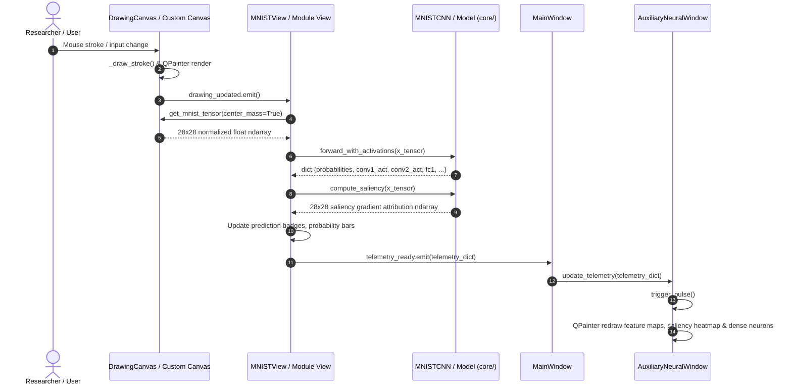
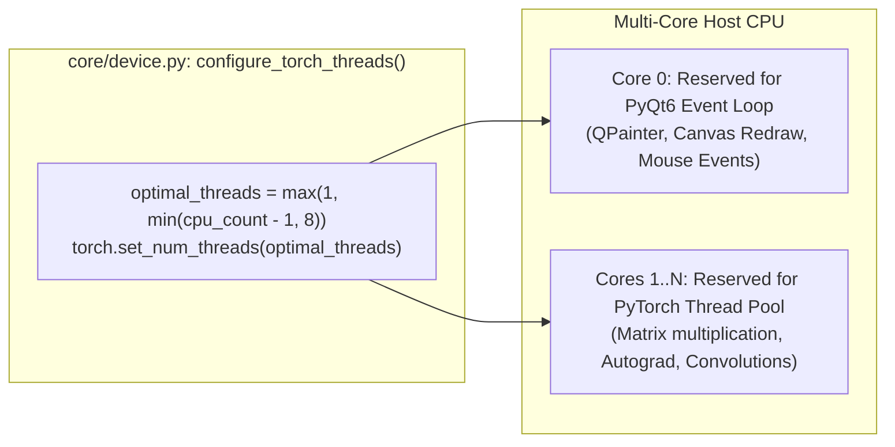

# 💻 NeuroNetWorks: Python Source Code Technical Reference & Architecture Map

Welcome to the **NeuroNetWorks Python Source Code Technical Reference**. While [`TECHNICAL_DOCUMENTATION.md`](file:///home/cyrus/Projects/Python_AI/NeuroNetWorks/TECHNICAL_DOCUMENTATION.md) provides theoretical and mathematical proofs and [`USER_MANUAL.md`](file:///home/cyrus/Projects/Python_AI/NeuroNetWorks/USER_MANUAL.md) serves as an end-user guide, this document is the **definitive developer and software architecture manual**. It explains how every Python module, class, method, function, and Deep Learning algorithm is implemented, how the system components connect, and how real-time tensor computation is integrated with the PyQt6 desktop event loop.

---

## 📑 Table of Contents
1. [High-Level Architecture & Project UML Maps](#1-high-level-architecture--project-uml-maps)
   - 1.1 [System Component Topology Diagram](#11-system-component-topology-diagram)
   - 1.2 [Core Deep Learning Class Diagram (UML)](#12-core-deep-learning-class-diagram-uml)
   - 1.3 [PyQt6 Presentation & Signal Flow Diagram](#13-pyqt6-presentation--signal-flow-diagram)
   - 1.4 [Tensor & Telemetry Dataflow Architecture](#14-tensor--telemetry-dataflow-architecture)
2. [Master Source Code File Directory](#2-master-source-code-file-directory)
   - 2.1 [Application Entry & Runtime Orchestration](#21-application-entry--runtime-orchestration)
   - 2.2 [Core Computational & Deep Learning Engine (`core/`)](#22-core-computational--deep-learning-engine-core)
   - 2.3 [User Interface & Presentation Layer (`ui/`)](#23-user-interface--presentation-layer-ui)
   - 2.4 [Dedicated Interactive Modules (`ui/modules/`)](#24-dedicated-interactive-modules-uimodules)
   - 2.5 [Automation & Test Harness (`scripts/`)](#25-automation--test-harness-scripts)
3. [Deep Learning Functions & Algorithmic Implementations](#3-deep-learning-functions--algorithmic-implementations)
   - 3.1 [Computer Vision & Convolutional Neural Networks](#31-computer-vision--convolutional-neural-networks)
   - 3.2 [Explainable AI (XAI) & Vanilla Backpropagation Saliency](#32-explainable-ai-xai--vanilla-backpropagation-saliency)
   - 3.3 [Non-Linear Decision Boundaries & Manifolds](#33-non-linear-decision-boundaries--manifolds)
   - 3.4 [Unsupervised Autoencoders & Latent Manifold Projection](#34-unsupervised-autoencoders--latent-manifold-projection)
   - 3.5 [Universal Function Approximation & Harmonic SIREN Activation](#35-universal-function-approximation--harmonic-siren-activation)
   - 3.6 [1D Temporal Convolutions & Waveform Denoising](#36-1d-temporal-convolutions--waveform-denoising)
   - 3.7 [Deep Reinforcement Learning (DQN) & Newtonian Dynamics](#37-deep-reinforcement-learning-dqn--newtonian-dynamics)
   - 3.8 [Vision Transformers (ViT) & Multi-Head Self-Attention](#38-vision-transformers-vit--multi-head-self-attention)
   - 3.9 [Adversarial Robustness, FGSM & Projected Gradient Descent (PGD)](#39-adversarial-robustness-fgsm--projected-gradient-descent-pgd)
   - 3.10 [Generative Flow Matching & 2D Diffusion Simulation](#310-generative-flow-matching--2d-diffusion-simulation)
   - 3.11 [Offline Pretraining Pipeline & Weight Serialization](#311-offline-pretraining-pipeline--weight-serialization)
4. [Hardware Virtualization & GUI Thread Isolation](#4-hardware-virtualization--gui-thread-isolation)
5. [Feature-to-File Implementation Matrix](#5-feature-to-file-implementation-matrix)

---

## 1. High-Level Architecture & Project UML Maps

### 1.1 System Component Topology Diagram

The NeuroNetWorks codebase follows a strict separation of concerns between **PyTorch / NumPy mathematical modeling** (`core/`), **PyQt6 desktop visual rendering** (`ui/` and `ui/modules/`), and **runtime lifecycle management** (`app.py`, `core/device.py`, `core/trainer.py`).

```mermaid
flowchart TD
    subgraph EntryPoint["Runtime Entry & Orchestration"]
        APP["app.py\n(CLI parser, thread setup, Qt bootstrap)"]
        DEV["core/device.py\n(CUDA / MPS / CPU detection & thread tuning)"]
        TRAIN["core/trainer.py\n(Pretraining pipeline & weight export)"]
    end

    subgraph ShellUI["Presentation Shell (PyQt6)"]
        MAIN["ui/main_window.py: MainWindow\n(Sidebar nav, stacked views, status bar)"]
        AUX["ui/auxiliary_window.py: AuxiliaryNeuralWindow\n(Pop-out multi-monitor activation inspector)"]
        THEME["ui/theme.py\n(Cyber-lab styling & design tokens)"]
        WIDGETS["ui/custom_widgets.py\n(Card, MetricBadge, LabeledSlider, PulseIndicator)"]
    end

    subgraph ModuleViews["Interactive View Modules (ui/modules/)"]
        VMNIST["mnist_view.py: MNISTView\nDrawingCanvas"]
        VBOUND["boundary_view.py: BoundaryView\nBoundaryCanvas"]
        VAUTO["autoencoder_view.py: AutoencoderView\nLatentSpaceCanvas"]
        VAPPROX["approximator_view.py: ApproximatorView\nCurveCanvas"]
        VSIGNAL["signal_view.py: SignalView\nOscilloscopeCanvas"]
        VCART["cartpole_view.py: CartPoleView\nPhysicsCanvas"]
        VTRANS["transformer_view.py: TransformerView\nPatchAttentionCanvas, AttentionMatrixCanvas"]
        VADV["adversarial_view.py: AdversarialView"]
        VDIFF["diffusion_view.py: DiffusionView\nDiffusionCanvas"]
    end

    subgraph CoreDL["Deep Learning Engine (core/)"]
        MMNIST["mnist_models.py\nMNISTCNN, MNISTMLP"]
        MBOUND["boundary_models.py\nDecisionBoundaryMLP, generate_2d_dataset"]
        MAUTO["autoencoder_models.py\nMNIST2DAutoencoder, add_noise_to_image"]
        MAPPROX["approximator_models.py\nFunctionApproximatorMLP, SineActivation"]
        MSIGNAL["signal_models.py\nSignalDenoising1DCNN, generate_synthetic_signal"]
        MCART["cartpole_models.py\nCartPoleEnv, QNetwork, DQNAgent"]
        MTRANS["transformer_models.py\nMiniVisionTransformer, MultiHeadSelfAttention"]
        MADV["adversarial_models.py\ngenerate_fgsm_attack, generate_pgd_attack"]
        MDIFF["diffusion_models.py\nFlowFieldMLP, DiffusionFlowSimulator"]
    end

    subgraph Assets["Disk Artifacts"]
        WEIGHTS[("models_weights/*.pth\nPretrained PyTorch checkpoints")]
        DATA[("data/mnist_samples.npz\nOffline evaluation dataset")]
    end

    APP --> DEV
    APP --> MAIN
    MAIN --> AUX
    MAIN --> THEME
    MAIN --> WIDGETS
    MAIN --> ModuleViews

    VMNIST --> MMNIST
    VMNIST -.->|telemetry_ready| AUX
    VBOUND --> MBOUND
    VAUTO --> MAUTO
    VAPPROX --> MAPPROX
    VSIGNAL --> MSIGNAL
    VCART --> MCART
    VTRANS --> MTRANS
    VADV --> MADV
    VDIFF --> MDIFF

    TRAIN --> CoreDL
    TRAIN --> WEIGHTS
    TRAIN --> DATA
    ModuleViews -.->|Load checkpoints| WEIGHTS
    ModuleViews -.->|Load samples| DATA
```



---

### 1.2 Core Deep Learning Class Diagram (UML)

This UML class diagram highlights the inheritance hierarchy rooted in `torch.nn.Module`, alongside the dedicated simulation agents and reinforcement learning environments.

```mermaid
classDiagram
    class Module {
        <<PyTorch>>
        +forward(*inputs)
        +state_dict()
        +load_state_dict()
        +eval()
        +train()
        +to(device)
    }

    class MNISTCNN {
        +conv1: Conv2d
        +relu1: ReLU
        +pool1: MaxPool2d
        +conv2: Conv2d
        +relu2: ReLU
        +pool2: MaxPool2d
        +fc1: Linear
        +dropout: Dropout
        +fc2: Linear
        +forward(x: Tensor) Tensor
        +forward_with_activations(x: Tensor) Dict
        +compute_saliency(x: Tensor, target_class: int) ndarray
    }

    class MNISTMLP {
        +fc1: Linear
        +relu1: ReLU
        +fc2: Linear
        +relu2: ReLU
        +fc3: Linear
        +forward(x: Tensor) Tensor
        +forward_with_activations(x: Tensor) Dict
    }

    class DecisionBoundaryMLP {
        +hidden_layers: List~int~
        +activation_name: str
        +net: Sequential
        +forward(x: Tensor) Tensor
        +predict_proba(x_np: ndarray) ndarray
    }

    class MNIST2DAutoencoder {
        +encoder: Sequential
        +decoder: Sequential
        +encode(x: Tensor) Tensor
        +decode(z: Tensor) Tensor
        +forward(x: Tensor) Tensor
    }

    class FunctionApproximatorMLP {
        +hidden_dim: int
        +num_layers: int
        +activation_name: str
        +hidden_net: Sequential
        +out_linear: Linear
        +forward(x: Tensor) Tensor
        +get_basis_neuron_outputs(x_np: ndarray) Tuple
    }

    class SineActivation {
        +w0: float
        +forward(x: Tensor) Tensor
    }

    class SignalDenoising1DCNN {
        +encoder: Sequential
        +decoder: Sequential
        +forward(x: Tensor) Tensor
    }

    class QNetwork {
        +net: Sequential
        +forward(state: Tensor) Tensor
    }

    class MultiHeadSelfAttention {
        +embed_dim: int
        +num_heads: int
        +head_dim: int
        +qkv: Linear
        +proj: Linear
        +last_attn_weights: Tensor
        +forward(x: Tensor) Tensor
    }

    class TransformerBlock {
        +norm1: LayerNorm
        +attn: MultiHeadSelfAttention
        +norm2: LayerNorm
        +mlp: Sequential
        +forward(x: Tensor) Tensor
    }

    class MiniVisionTransformer {
        +img_size: int
        +patch_size: int
        +num_patches: int
        +embed_dim: int
        +patch_embed: Linear
        +cls_token: Parameter
        +pos_embed: Parameter
        +blocks: ModuleList
        +norm: LayerNorm
        +head: Linear
        +forward_features(x: Tensor) Tuple
        +forward(x: Tensor) Tensor
        +forward_with_attention(x: Tensor) Dict
    }

    class FlowFieldMLP {
        +time_mlp: SinusoidalPositionalEmbedding
        +net: Sequential
        +forward(x: Tensor, t: Tensor) Tensor
    }

    class SinusoidalPositionalEmbedding {
        +dim: int
        +forward(t: Tensor) Tensor
    }

    Module <|-- MNISTCNN
    Module <|-- MNISTMLP
    Module <|-- DecisionBoundaryMLP
    Module <|-- MNIST2DAutoencoder
    Module <|-- FunctionApproximatorMLP
    Module <|-- SineActivation
    Module <|-- SignalDenoising1DCNN
    Module <|-- QNetwork
    Module <|-- MultiHeadSelfAttention
    Module <|-- TransformerBlock
    Module <|-- MiniVisionTransformer
    Module <|-- FlowFieldMLP
    Module <|-- SinusoidalPositionalEmbedding

    class CartPoleEnv {
        +gravity: float
        +mass_cart: float
        +mass_pole: float
        +total_mass: float
        +length: float
        +force_mag: float
        +tau: float
        +state: ndarray
        +reset(random_init: bool) ndarray
        +step(action: int, external_disturbance: float) Tuple
    }

    class DQNAgent {
        +state_dim: int
        +action_dim: int
        +gamma: float
        +epsilon: float
        +q_net: QNetwork
        +target_net: QNetwork
        +replay_buffer: deque
        +select_action(state: ndarray, evaluate: bool) Tuple
        +remember(state, action, reward, next_state, done)
        +train_step() float
        +update_target_network()
    }

    class DiffusionFlowSimulator {
        +shape_name: str
        +target_pts: ndarray
        +model: FlowFieldMLP
        +optimizer: Adam
        +set_shape(shape_name: str)
        +compute_sampling_trajectory(n_particles: int, steps: int) ndarray
        +get_vector_field_grid(t_val: float, grid_res: int) Tuple
    }

    DQNAgent --> QNetwork : uses 2 instances (eval and target)
    DiffusionFlowSimulator --> FlowFieldMLP : trains and evaluates ODE field
```



---

### 1.3 PyQt6 Presentation & Signal Flow Diagram

The user interface utilizes an asynchronous **Qt Signal / Slot** architecture to decouple UI mouse events and timer events from PyTorch compute operations.



---

### 1.4 Tensor & Telemetry Dataflow Architecture

The table below traces how tensor shapes mutate across the lifecycle of each module:

```
[User Input Event]
      │ (Pixel coordinates, UI Sliders, Synthetic Signal Generative Functions)
      ▼
[Input Tensor Transformation]
      │ Reshape, Typecast (float32), Device Transfer (.to(device))
      ▼
┌────────────────────────────────────────────────────────┐
│               PYTORCH FORWARD / BACKWARD               │
│  • Forward Propagation:  Z = W · X + b                 │
│  • Activation Functions: ReLU, GELU, Sigmoid, SIREN    │
│  • Loss & Autograd:      L = Loss(Z, Y) -> backward()  │
│  • Intermediate Tapping: Activations & Weights Stored  │
└────────────────────────────────────────────────────────┘
      │
      ▼
[Telemetry Extraction]
      │ .detach().cpu().numpy() (Zero GPU Memory Leak)
      ▼
[NumPy Normalization & Color Mapping]
      │ Min-Max scaling, Jet/Plasma false-color colormaps
      ▼
[PyQt6 QImage / QPixmap Conversion]
      │ QImage(data, W, H, Format_Grayscale8 / Format_RGB32)
      ▼
[QPainter Hardware Rendering on Canvas @ 60 FPS]
```

---

## 2. Master Source Code File Directory

This section provides a rigorous file-by-file breakdown of every source file in the repository.

### 2.1 Application Entry & Runtime Orchestration

#### [`app.py`](file:///home/cyrus/Projects/Python_AI/NeuroNetWorks/app.py)
* **Path:** `app.py`
* **Role:** Master execution bootstrap and CLI entry point.
* **Imports:** `argparse`, `sys`, `os`, `PyQt6.QtWidgets.QApplication`, [`core.device.configure_torch_threads`](file:///home/cyrus/Projects/Python_AI/NeuroNetWorks/core/device.py#L25-L30), [`ui.main_window.MainWindow`](file:///home/cyrus/Projects/Python_AI/NeuroNetWorks/ui/main_window.py#L33-L273).
* **Key Functions:**
  - [`parse_args()`](file:///home/cyrus/Projects/Python_AI/NeuroNetWorks/app.py#L19-L23): Parses command-line flags:
    - `--test`: Triggers non-interactive automated self-test across all 9 modules and exits.
    - `--module <idx>`: Boots the desktop app directly into a chosen module index (0 to 8).
  - [`main()`](file:///home/cyrus/Projects/Python_AI/NeuroNetWorks/app.py#L25-L97): Calls thread allocation, creates `QApplication`, initializes `MainWindow`, executes unit-level operational checks when in `--test` mode, and starts Qt's event loop via `app.exec()`.

---

### 2.2 Core Computational & Deep Learning Engine (`core/`)

#### [`core/device.py`](file:///home/cyrus/Projects/Python_AI/NeuroNetWorks/core/device.py)
* **Path:** `core/device.py`
* **Role:** Hardware device detection, accelerator dispatching, and thread allocation.
* **Key Functions:**
  - [`get_device() -> torch.device`](file:///home/cyrus/Projects/Python_AI/NeuroNetWorks/core/device.py#L6-L12): Probes compute hardware hierarchically:
    1. Returns `cuda` if `torch.cuda.is_available()` is True.
    2. Returns `mps` if Apple Silicon Metal Performance Shaders are available.
    3. Defaults to `cpu`.
  - [`get_device_name() -> str`](file:///home/cyrus/Projects/Python_AI/NeuroNetWorks/core/device.py#L14-L23): Produces formatted human-readable hardware telemetry strings (e.g. `CUDA: NVIDIA GeForce RTX 3080` or `Intel / CPU (7 threads)`).
  - [`configure_torch_threads()`](file:///home/cyrus/Projects/Python_AI/NeuroNetWorks/core/device.py#L25-L30): Enforces desktop thread isolation. Calculates `optimal_threads = max(1, min(cpu_count - 1, 8))` and applies `torch.set_num_threads(optimal_threads)`. Prevents CPU saturation so the PyQt6 GUI main event loop maintains 60 FPS without stutter.

#### [`core/mnist_models.py`](file:///home/cyrus/Projects/Python_AI/NeuroNetWorks/core/mnist_models.py)
* **Path:** `core/mnist_models.py`
* **Role:** Computer vision models for handwritten digit classification, multi-layer activation inspection, and explainable AI (XAI).
* **Classes:**
  - [`MNISTCNN(nn.Module)`](file:///home/cyrus/Projects/Python_AI/NeuroNetWorks/core/mnist_models.py#L9-L96):
    - `conv1`: `nn.Conv2d(1, 16, kernel_size=3, padding=1)`
    - `pool1`: `nn.MaxPool2d(2, 2)`
    - `conv2`: `nn.Conv2d(16, 32, kernel_size=3, padding=1)`
    - `pool2`: `nn.MaxPool2d(2, 2)`
    - `fc1`: `nn.Linear(32 * 7 * 7, 128)`
    - `dropout`: `nn.Dropout(0.2)`
    - `fc2`: `nn.Linear(128, 10)`
    - [`forward(x)`](file:///home/cyrus/Projects/Python_AI/NeuroNetWorks/core/mnist_models.py#L30-L36): Computes standard forward propagation pass.
    - [`forward_with_activations(x) -> Dict[str, np.ndarray]`](file:///home/cyrus/Projects/Python_AI/NeuroNetWorks/core/mnist_models.py#L38-L67): Executes forward inference while extracting intermediate feature maps and layer tensors: `input`, `conv1_raw`, `conv1_act`, `pool1`, `conv2_raw`, `conv2_act`, `pool2`, `fc1`, `logits`, and `probabilities`.
    - [`compute_saliency(x, target_class=None) -> np.ndarray`](file:///home/cyrus/Projects/Python_AI/NeuroNetWorks/core/mnist_models.py#L69-L96): Computes pixel-level Vanilla Backpropagation attribution gradients $\mathcal{S}(x, y) = |\frac{\partial z_c}{\partial \mathbf{X}_{x, y}}|$. Normalizes values to $[0, 1]$ for visual overlay.
  - [`MNISTMLP(nn.Module)`](file:///home/cyrus/Projects/Python_AI/NeuroNetWorks/core/mnist_models.py#L98-L131): Dense 3-layer benchmark MLP ($784 \to 128 \to 64 \to 10$) with [`forward_with_activations(x)`](file:///home/cyrus/Projects/Python_AI/NeuroNetWorks/core/mnist_models.py#L116-L131).

#### [`core/boundary_models.py`](file:///home/cyrus/Projects/Python_AI/NeuroNetWorks/core/boundary_models.py)
* **Path:** `core/boundary_models.py`
* **Role:** Configurable Multi-Layer Perceptron for 2D binary classification and 2D non-linear synthetic dataset generation.
* **Classes & Functions:**
  - [`DecisionBoundaryMLP(nn.Module)`](file:///home/cyrus/Projects/Python_AI/NeuroNetWorks/core/boundary_models.py#L8-L49): Dynamically constructed MLP supporting variable hidden layer widths (e.g. `[16, 16]`, `[32, 32, 16]`) and pluggable activation functions: ReLU, Tanh, Sigmoid, GELU, and LeakyReLU.
    - [`forward(x)`](file:///home/cyrus/Projects/Python_AI/NeuroNetWorks/core/boundary_models.py#L39-L40): Forward pass yielding 2-class unnormalized logits.
    - [`predict_proba(x_np) -> np.ndarray`](file:///home/cyrus/Projects/Python_AI/NeuroNetWorks/core/boundary_models.py#L42-L49): Vectorized evaluation taking coordinate grid points $[N, 2]$ and returning Softmax probabilities for Class 1 without holding computation graphs in memory (`torch.no_grad()`).
  - [`generate_2d_dataset(dataset_type, n_samples, noise, random_state)`](file:///home/cyrus/Projects/Python_AI/NeuroNetWorks/core/boundary_models.py#L52-L126): Procedural generator for standard machine learning benchmark manifolds:
    - `"spirals"`: Archimedean dual intertwined spirals.
    - `"moons"`: Interleaved crescent half-circles.
    - `"circles"`: Concentric inner and outer rings.
    - `"xor"`: Four-quadrant XOR parity problem.
    - `"clusters"`: Gaussian bivariate clusters with adjustable noise variance.

#### [`core/autoencoder_models.py`](file:///home/cyrus/Projects/Python_AI/NeuroNetWorks/core/autoencoder_models.py)
* **Path:** `core/autoencoder_models.py`
* **Role:** Deep autoencoding, extreme 2D latent bottleneck compression, image reconstruction, and noise corruption utilities.
* **Classes & Functions:**
  - [`MNIST2DAutoencoder(nn.Module)`](file:///home/cyrus/Projects/Python_AI/NeuroNetWorks/core/autoencoder_models.py#L8-L53):
    - **Encoder:** $784 \to \text{Linear}(256) \to \text{BN} \to \text{LeakyReLU}(0.2) \to \text{Linear}(64) \to \text{BN} \to \text{LeakyReLU}(0.2) \to \text{Linear}(2)$. Compresses a $28 \times 28$ image into a 2D Cartesian coordinate $(z_1, z_2)$.
    - **Decoder:** $2 \to \text{Linear}(64) \to \text{BN} \to \text{LeakyReLU}(0.2) \to \text{Linear}(256) \to \text{BN} \to \text{LeakyReLU}(0.2) \to \text{Linear}(784) \to \text{Sigmoid}()$. Reconstructs the 2D code back into $1 \times 28 \times 28$ pixel intensities in $[0, 1]$.
    - [`encode(x)`](file:///home/cyrus/Projects/Python_AI/NeuroNetWorks/core/autoencoder_models.py#L39-L43): Extracts $(z_1, z_2)$ latent coordinates.
    - [`decode(z)`](file:///home/cyrus/Projects/Python_AI/NeuroNetWorks/core/autoencoder_models.py#L45-L48): Generative decoding from arbitrary $(z_1, z_2)$ points.
    - [`forward(x)`](file:///home/cyrus/Projects/Python_AI/NeuroNetWorks/core/autoencoder_models.py#L50-L53): End-to-end reconstruction forward pass.
  - [`add_noise_to_image(img_np, noise_type, intensity)`](file:///home/cyrus/Projects/Python_AI/NeuroNetWorks/core/autoencoder_models.py#L56-L81): Injects controlled corruption: Gaussian additive noise, Salt & Pepper impulsive dropout, or rectangular spatial occlusion.
  - [`compute_reconstruction_metrics(original, reconstructed)`](file:///home/cyrus/Projects/Python_AI/NeuroNetWorks/core/autoencoder_models.py#L84-L91): Calculates Mean Squared Error (MSE) and Peak Signal-to-Noise Ratio (PSNR in dB).

#### [`core/approximator_models.py`](file:///home/cyrus/Projects/Python_AI/NeuroNetWorks/core/approximator_models.py)
* **Path:** `core/approximator_models.py`
* **Role:** Universal function approximator (1D regression) MLP, SIREN harmonic activation layer, and hidden neuron basis curve decomposition.
* **Classes & Functions:**
  - [`SineActivation(nn.Module)`](file:///home/cyrus/Projects/Python_AI/NeuroNetWorks/core/approximator_models.py#L8-L15): Implements periodic activation $\phi(x) = \sin(\omega_0 \cdot x)$ as introduced in SIREN architectures (Sitzmann et al.).
  - [`FunctionApproximatorMLP(nn.Module)`](file:///home/cyrus/Projects/Python_AI/NeuroNetWorks/core/approximator_models.py#L18-L78): Arbitrary depth MLP ($1 \to H \to \dots \to H \to 1$) with selectable activations (ReLU, Tanh, Sigmoid, SIREN, GELU).
    - [`forward(x)`](file:///home/cyrus/Projects/Python_AI/NeuroNetWorks/core/approximator_models.py#L55-L57): Evaluates scalar predictions $\hat{y} = f(x)$.
    - [`get_basis_neuron_outputs(x_np) -> Tuple[np.ndarray, np.ndarray]`](file:///home/cyrus/Projects/Python_AI/NeuroNetWorks/core/approximator_models.py#L59-L78): Deconstructs the final prediction into the individual contributions of each hidden neuron: $c_i(x) = W_i \cdot h_i(x)$. This visualizes how the network forms a composite curve by summing individual continuous basis functions.
  - [`get_target_function(name)`](file:///home/cyrus/Projects/Python_AI/NeuroNetWorks/core/approximator_models.py#L81-L95): Factory producing mathematical benchmark curves: Standard Sine, Damped Sine wave, Runge's polynomial rational function, Harmonic multi-frequency chord, Square step function, and Sawtooth wave.

#### [`core/signal_models.py`](file:///home/cyrus/Projects/Python_AI/NeuroNetWorks/core/signal_models.py)
* **Path:** `core/signal_models.py`
* **Role:** 1D fully-convolutional deep neural networks for continuous signal denoising, procedural waveform generation, and SNR metric telemetry.
* **Classes & Functions:**
  - [`SignalDenoising1DCNN(nn.Module)`](file:///home/cyrus/Projects/Python_AI/NeuroNetWorks/core/signal_models.py#L8-L34):
    - **Encoder:** $\text{Conv1d}(1 \to 32, k=9, p=4) \to \text{BN} \to \text{LeakyReLU} \to \text{Conv1d}(32 \to 64, k=7, p=3) \to \text{BN} \to \text{LeakyReLU}$.
    - **Decoder:** $\text{Conv1d}(64 \to 32, k=7, p=3) \to \text{BN} \to \text{LeakyReLU} \to \text{Conv1d}(32 \to 16, k=5, p=2) \to \text{LeakyReLU} \to \text{Conv1d}(16 \to 1, k=5, p=2)$.
    - Operates as a temporal bandpass filter preserving phase and amplitude while stripping noise.
  - [`generate_synthetic_signal(signal_type, time_points, freq)`](file:///home/cyrus/Projects/Python_AI/NeuroNetWorks/core/signal_models.py#L37-L81): Procedural generator for synthetic ECG (P-Q-R-S-T cardiac waves), Linear frequency Chirp sweeps, Acoustic harmonic chords, and Band-limited square waves.
  - [`inject_noise(clean, noise_level, noise_mode, hum_freq, time_points)`](file:///home/cyrus/Projects/Python_AI/NeuroNetWorks/core/signal_models.py#L83-L111): Injects Gaussian white noise, impulsive pops/spikes, or 60 Hz powerline hum.
  - [`compute_snr_gain(clean, noisy, denoised)`](file:///home/cyrus/Projects/Python_AI/NeuroNetWorks/core/signal_models.py#L114-L128): Evaluates Signal-to-Noise Ratio (in dB) before and after filtering, reporting net decibel improvement $\Delta \text{SNR} = \text{SNR}_{\text{out}} - \text{SNR}_{\text{in}}$.

#### [`core/cartpole_models.py`](file:///home/cyrus/Projects/Python_AI/NeuroNetWorks/core/cartpole_models.py)
* **Path:** `core/cartpole_models.py`
* **Role:** Newtonian physics simulator for inverted pendulum on a cart, combined with Deep Q-Network (DQN) reinforcement learning agent.
* **Classes:**
  - [`CartPoleEnv`](file:///home/cyrus/Projects/Python_AI/NeuroNetWorks/core/cartpole_models.py#L10-L88):
    - State vector: $\mathbf{s} = [x, \dot{x}, \theta, \dot{\theta}]$ (position, cart velocity, pole angle, angular velocity).
    - Solves the nonlinear equations of motion using **Euler-Cromer symplectic integration** ($\Delta t = 0.02\,\text{s}$).
    - Supports interactive external physical disturbance forces injected in real time by the user.
    - [`reset(random_init=True)`](file:///home/cyrus/Projects/Python_AI/NeuroNetWorks/core/cartpole_models.py#L42-L48): Resets state with small stochastic perturbations.
    - [`step(action, external_disturbance)`](file:///home/cyrus/Projects/Python_AI/NeuroNetWorks/core/cartpole_models.py#L50-L88): Advances the simulation by $\tau = 0.02\,\text{s}$, returning $(\mathbf{s}_{t+1}, r_t, \text{done}, \{\})$.
  - [`QNetwork(nn.Module)`](file:///home/cyrus/Projects/Python_AI/NeuroNetWorks/core/cartpole_models.py#L91-L105): 3-layer MLP ($4 \to 64 \to 64 \to 2$) estimating action-value function $Q(s, a)$.
  - [`DQNAgent`](file:///home/cyrus/Projects/Python_AI/NeuroNetWorks/core/cartpole_models.py#L108-L188):
    - Implements Deep Q-Learning with experience replay buffer (`collections.deque`, capacity 10,000), target network stabilization, and decaying $\epsilon$-greedy exploration policy ($\epsilon_t = \max(\epsilon_{\min}, \epsilon_t \cdot \gamma_{\epsilon})$).
    - [`select_action(state, evaluate=False) -> Tuple[int, np.ndarray]`](file:///home/cyrus/Projects/Python_AI/NeuroNetWorks/core/cartpole_models.py#L139-L150): Chooses action $a \in \{0, 1\}$ and returns raw Q-values for visual display.
    - [`remember(state, action, reward, next_state, done)`](file:///home/cyrus/Projects/Python_AI/NeuroNetWorks/core/cartpole_models.py#L152-L153): Enqueues transitions into replay buffer.
    - [`train_step() -> float`](file:///home/cyrus/Projects/Python_AI/NeuroNetWorks/core/cartpole_models.py#L155-L185): Samples uniform mini-batch of 64 transitions, computes Bellman target $y_i = r_i + \gamma (1 - d_i) \max_{a'} Q_{\text{target}}(s'_i, a')$, and optimizes MSE loss via Adam.
    - [`update_target_network()`](file:///home/cyrus/Projects/Python_AI/NeuroNetWorks/core/cartpole_models.py#L187-L188): Clones evaluation weights into target network.

#### [`core/transformer_models.py`](file:///home/cyrus/Projects/Python_AI/NeuroNetWorks/core/transformer_models.py)
* **Path:** `core/transformer_models.py`
* **Role:** Vision Transformer (ViT) implementation for 28x28 digit images, patch token decomposition, and multi-head attention weight retention.
* **Classes:**
  - [`MultiHeadSelfAttention(nn.Module)`](file:///home/cyrus/Projects/Python_AI/NeuroNetWorks/core/transformer_models.py#L9-L35):
    - Projects tokens into Query, Key, and Value tensors via `self.qkv`.
    - Computes Scaled Dot-Product Attention: $\text{Softmax}\left(\frac{\mathbf{Q} \mathbf{K}^T}{\sqrt{d_k}}\right) \mathbf{V}$.
    - Stores attention weight matrices in `self.last_attn_weights` ($[B, H, N, N]$) for telemetry visualization.
  - [`TransformerBlock(nn.Module)`](file:///home/cyrus/Projects/Python_AI/NeuroNetWorks/core/transformer_models.py#L38-L56): Pre-LayerNorm Transformer block featuring MHSA, GELU two-layer MLP, and residual skip connections: $\mathbf{x}' = \mathbf{x} + \text{MHSA}(\text{LN}(\mathbf{x}))$, $\mathbf{x}_{\text{out}} = \mathbf{x}' + \text{MLP}(\text{LN}(\mathbf{x}'))$.
  - [`MiniVisionTransformer(nn.Module)`](file:///home/cyrus/Projects/Python_AI/NeuroNetWorks/core/transformer_models.py#L59-L147):
    - Breaks $28 \times 28$ image into 16 non-overlapping patches of $7 \times 7$ pixels using `Tensor.unfold()`.
    - Projects each 49-dimensional patch into an embedding space ($d = 64$) via `self.patch_embed`.
    - Prepends a learnable `[CLS]` classification token (`1 x 1 x 64`) and adds learnable 1D positional embeddings (`1 x 17 x 64`).
    - Passes the 17-token sequence through a stack of Transformer blocks.
    - [`forward_with_attention(x) -> Dict[str, np.ndarray]`](file:///home/cyrus/Projects/Python_AI/NeuroNetWorks/core/transformer_models.py#L128-L147): Performs inference and returns logits, softmax probabilities, full $17 \times 17$ attention matrices per head, `[CLS]` token attention distribution, and individual patch pixels.

#### [`core/adversarial_models.py`](file:///home/cyrus/Projects/Python_AI/NeuroNetWorks/core/adversarial_models.py)
* **Path:** `core/adversarial_models.py`
* **Role:** Adversarial perturbation attacks and robustness evaluation algorithms.
* **Key Functions:**
  - [`generate_fgsm_attack(model, image_tensor, epsilon, target_class, true_class)`](file:///home/cyrus/Projects/Python_AI/NeuroNetWorks/core/adversarial_models.py#L9-L59): Fast Gradient Sign Method (Goodfellow et al., 2014).
    - Untargeted: $\mathbf{x}_{\text{adv}} = \text{clip}\left(\mathbf{x} + \epsilon \cdot \text{sign}(\nabla_\mathbf{x} \mathcal{L}(\mathbf{x}, y_{\text{true}})), 0, 1\right)$.
    - Targeted: $\mathbf{x}_{\text{adv}} = \text{clip}\left(\mathbf{x} - \epsilon \cdot \text{sign}(\nabla_\mathbf{x} \mathcal{L}(\mathbf{x}, y_{\text{target}})), 0, 1\right)$.
    - Returns adversarial image, pure noise difference, and $L_\infty, L_2, \text{MSE}$ metrics.
  - [`generate_pgd_attack(model, image_tensor, epsilon, alpha, steps, target_class, true_class)`](file:///home/cyrus/Projects/Python_AI/NeuroNetWorks/core/adversarial_models.py#L62-L110): Projected Gradient Descent (Madry et al., 2018).
    - Multi-step iterative gradient ascent initialized with uniform random perturbation within the $L_\infty$ $\epsilon$-ball: $\mathbf{x}^{(t+1)} = \Pi_{\mathcal{B}_\epsilon(\mathbf{x})}\left(\mathbf{x}^{(t)} + \alpha \cdot \text{sign}(\nabla_{\mathbf{x}^{(t)}} \mathcal{L})\right)$.
    - Enforces strict projection $\Pi$ back onto $[\mathbf{x} - \epsilon, \mathbf{x} + \epsilon] \cap [0, 1]$ after every step.

#### [`core/diffusion_models.py`](file:///home/cyrus/Projects/Python_AI/NeuroNetWorks/core/diffusion_models.py)
* **Path:** `core/diffusion_models.py`
* **Role:** Continuous-time generative Flow Matching and 2D toy diffusion model simulator.
* **Classes & Functions:**
  - [`SinusoidalPositionalEmbedding(nn.Module)`](file:///home/cyrus/Projects/Python_AI/NeuroNetWorks/core/diffusion_models.py#L8-L20): Projects continuous scalar time $t \in [0, 1]$ into a 16-dimensional sinusoidal embedding vector using geometrically spaced frequencies: $[\sin(\omega_k t), \cos(\omega_k t)]$.
  - [`FlowFieldMLP(nn.Module)`](file:///home/cyrus/Projects/Python_AI/NeuroNetWorks/core/diffusion_models.py#L23-L43): Deep velocity vector field approximator $v_\theta(x, t): \mathbb{R}^2 \times \mathbb{R} \to \mathbb{R}^2$ with SiLU activations.
  - [`generate_2d_shape_points(shape_name, n_points)`](file:///home/cyrus/Projects/Python_AI/NeuroNetWorks/core/diffusion_models.py#L46-L86): Synthesizes target 2D manifolds: Heart curve, Swiss Roll spiral, Concentric Rings, and Two Moons.
  - [`DiffusionFlowSimulator`](file:///home/cyrus/Projects/Python_AI/NeuroNetWorks/core/diffusion_models.py#L89-L171):
    - [`_pretrain_quick(epochs=120)`](file:///home/cyrus/Projects/Python_AI/NeuroNetWorks/core/diffusion_models.py#L100-L125): Pre-trains the flow matching model using optimal transport linear probability paths $x_t = (1 - t)x_0 + t x_1$ with target velocity $v = x_1 - x_0$ where $x_0 \sim \mathcal{N}(0, \mathbf{I})$ and $x_1 \sim p_{\text{data}}$.
    - [`compute_sampling_trajectory(n_particles, steps) -> np.ndarray`](file:///home/cyrus/Projects/Python_AI/NeuroNetWorks/core/diffusion_models.py#L134-L153): Integrates the learned ODE $\frac{dx}{dt} = v_\theta(x, t)$ from $t = 0$ (pure noise) to $t = 1$ (structured geometry) using Euler integration: $x_{t+\Delta t} = x_t + v_\theta(x_t, t) \Delta t$.
    - [`get_vector_field_grid(t_val, grid_res)`](file:///home/cyrus/Projects/Python_AI/NeuroNetWorks/core/diffusion_models.py#L155-L171): Evaluates $v_\theta(x, t)$ on a regular Cartesian grid at time $t$ for real-time vector field visualization.

#### [`core/trainer.py`](file:///home/cyrus/Projects/Python_AI/NeuroNetWorks/core/trainer.py)
* **Path:** `core/trainer.py`
* **Role:** Offline asset preparation, dataset caching, and pre-training pipeline for model checkpoints.
* **Key Functions:**
  - [`ensure_dirs()`](file:///home/cyrus/Projects/Python_AI/NeuroNetWorks/core/trainer.py#L22-L24): Verifies creation of `models_weights/` and `data/` directories.
  - [`train_and_export_mnist_cnn(epochs=2)`](file:///home/cyrus/Projects/Python_AI/NeuroNetWorks/core/trainer.py#L26-L67): Downloads MNIST via torchvision, trains `MNISTCNN` to >98% accuracy with Adam ($\text{lr}=0.002$), evaluates test set, and exports state dict to `models_weights/mnist_cnn.pth`.
  - [`export_mnist_samples(num_per_class=100)`](file:///home/cyrus/Projects/Python_AI/NeuroNetWorks/core/trainer.py#L69-L94): Curates 100 balanced test samples per digit class ($0-9$) and saves compressed arrays to `data/mnist_samples.npz` for instant offline testing.
  - [`train_and_export_mnist_autoencoder(epochs=4)`](file:///home/cyrus/Projects/Python_AI/NeuroNetWorks/core/trainer.py#L96-L124): Trains `MNIST2DAutoencoder` with MSE reconstruction loss and saves weights to `models_weights/mnist_autoencoder.pth`.
  - [`train_and_export_signal_denoiser(iterations=600)`](file:///home/cyrus/Projects/Python_AI/NeuroNetWorks/core/trainer.py#L126-L164): Trains `SignalDenoising1DCNN` across noisy synthetic waveforms and exports weights to `models_weights/signal_denoiser.pth`.
  - [`train_and_export_cartpole_dqn(target_episodes=160)`](file:///home/cyrus/Projects/Python_AI/NeuroNetWorks/core/trainer.py#L166-L199): Trains `DQNAgent` using custom reward shaping until 300+ balance duration is achieved; exports weights to `models_weights/cartpole_dqn.pth`.
  - [`run_all_pretraining()`](file:///home/cyrus/Projects/Python_AI/NeuroNetWorks/core/trainer.py#L201-L209): Orchestrates the complete end-to-end asset generation pipeline.

---

### 2.3 User Interface & Presentation Layer (`ui/`)

#### [`ui/theme.py`](file:///home/cyrus/Projects/Python_AI/NeuroNetWorks/ui/theme.py)
* **Path:** `ui/theme.py`
* **Role:** Design tokens, dark mode cyber-lab color palette, and global Qt CSS stylesheets.
* **Constants:**
  - Surface colors: `COLOR_BG_DARK = "#090D16"`, `COLOR_BG_CARD = "#111827"`, `COLOR_BG_SURFACE = "#1E293B"`, `COLOR_BG_HOVER = "#334155"`.
  - Borders: `COLOR_BORDER = "#334155"`, `COLOR_BORDER_LIGHT = "#475569"`.
  - Accent palette: `COLOR_ACCENT_CYAN = "#00E5FF"`, `COLOR_ACCENT_PURPLE = "#A855F7"`, `COLOR_ACCENT_GREEN = "#10B981"`, `COLOR_ACCENT_AMBER = "#F59E0B"`, `COLOR_ACCENT_RED = "#EF4444"`.
  - Typography: `COLOR_TEXT_PRIMARY = "#F8FAFC"`, `COLOR_TEXT_SECONDARY = "#94A3B8"`, `COLOR_TEXT_MUTED = "#64748B"`.
  - `GLOBAL_STYLESHEET`: Comprehensive QSS defining scrollbars, buttons, sliders, tab bars, headers, and tooltips.

#### [`ui/custom_widgets.py`](file:///home/cyrus/Projects/Python_AI/NeuroNetWorks/ui/custom_widgets.py)
* **Path:** `ui/custom_widgets.py`
* **Role:** Reusable PyQt6 UI component library.
* **Classes:**
  - [`Card(QFrame)`](file:///home/cyrus/Projects/Python_AI/NeuroNetWorks/ui/custom_widgets.py#L14-L44): Styled container with rounded corners and border styling for modular panels.
  - [`MetricBadge(QFrame)`](file:///home/cyrus/Projects/Python_AI/NeuroNetWorks/ui/custom_widgets.py#L47-L99): High-contrast numerical telemetry display card with customizable accent color and units.
  - [`LabeledSlider(QWidget)`](file:///home/cyrus/Projects/Python_AI/NeuroNetWorks/ui/custom_widgets.py#L102-L171): Horizontal slider linked with an immediate numeric indicator badge and `valueChanged` signal supporting both integer and floating-point ranges.
  - [`PulseIndicator(QWidget)`](file:///home/cyrus/Projects/Python_AI/NeuroNetWorks/ui/custom_widgets.py#L174-L205): Hardware status LED indicator featuring smooth pulsing QPainter glow animations.
  - [`EducationalPanel(QFrame)`](file:///home/cyrus/Projects/Python_AI/NeuroNetWorks/ui/custom_widgets.py#L208-L261): Collapsible accordion card that provides interactive theoretical and mathematical guidance directly within the interface.

#### [`ui/main_window.py`](file:///home/cyrus/Projects/Python_AI/NeuroNetWorks/ui/main_window.py)
* **Path:** `ui/main_window.py`
* **Role:** Application main shell coordinating navigation, stacked module widgets, and auxiliary telemetry windows.
* **Classes:**
  - [`MainWindow(QMainWindow)`](file:///home/cyrus/Projects/Python_AI/NeuroNetWorks/ui/main_window.py#L33-L273):
    - Instantiates all 9 module views and mounts them inside a `QStackedWidget`.
    - Creates the top header brand banner with hardware accelerator status (`core.device.get_device_name()`).
    - Constructs the navigation sidebar with exclusive `QButtonGroup` module selectors.
    - Connects `view_mnist.telemetry_ready` to [`AuxiliaryNeuralWindow.update_telemetry`](file:///home/cyrus/Projects/Python_AI/NeuroNetWorks/ui/auxiliary_window.py#L306-L343).
    - Manages the pop-out lifecycle of [`self.aux_window`](file:///home/cyrus/Projects/Python_AI/NeuroNetWorks/ui/auxiliary_window.py#L126-L378).

#### [`ui/auxiliary_window.py`](file:///home/cyrus/Projects/Python_AI/NeuroNetWorks/ui/auxiliary_window.py)
* **Path:** `ui/auxiliary_window.py`
* **Role:** Multi-monitor standalone neural inspector displaying deep activation telemetry, convolutional feature maps, and saliency maps.
* **Classes:**
  - [`ArchitectureFlowCanvas(QWidget)`](file:///home/cyrus/Projects/Python_AI/NeuroNetWorks/ui/auxiliary_window.py#L21-L123): Animated 2D schematic diagram of the neural network layers (Input $\to$ Conv1 $\to$ Pool1 $\to$ Conv2 $\to$ Pool2 $\to$ FC1 $\to$ Output) with a propagating cyan signal pulse wave rendered via `paintEvent`.
  - [`AuxiliaryNeuralWindow(QMainWindow)`](file:///home/cyrus/Projects/Python_AI/NeuroNetWorks/ui/auxiliary_window.py#L126-L378):
    - Tab 1: **Convolutional Feature Maps** (`_create_feature_maps_tab`): Renders 16 channels of Conv1 ($28 \times 28$) and 32 channels of Conv2 ($14 \times 14$) as a false-color tile grid.
    - Tab 2: **Saliency Attribution** (`_create_saliency_tab`): Side-by-side display of input digit, Vanilla Backprop gradient heatmap, and high-contrast attribution overlay.
    - Tab 3: **Dense Layer Activity** (`_create_dense_tab`): Visualizes all 128 hidden neurons of FC1 as an activity bar chart / activation grid alongside output logits.
    - [`update_telemetry(data: dict)`](file:///home/cyrus/Projects/Python_AI/NeuroNetWorks/ui/auxiliary_window.py#L306-L343): Slot receiving model activations, triggering layer pulse animations, and refreshing all tabs.
    - [`_numpy_to_pixmap(arr)`](file:///home/cyrus/Projects/Python_AI/NeuroNetWorks/ui/auxiliary_window.py#L345-L378): Converts raw 2D NumPy float arrays into colored `QPixmap` instances using an analytical false-color colormap.

---

### 2.4 Dedicated Interactive Modules (`ui/modules/`)

#### [`ui/modules/mnist_view.py`](file:///home/cyrus/Projects/Python_AI/NeuroNetWorks/ui/modules/mnist_view.py)
* **Path:** `ui/modules/mnist_view.py`
* **Role:** Interactive handwriting digit canvas, real-time inference, and telemetry dispatcher.
* **Classes:**
  - [`DrawingCanvas(QWidget)`](file:///home/cyrus/Projects/Python_AI/NeuroNetWorks/ui/modules/mnist_view.py#L28-L126): $280 \times 280$ anti-aliased drawing canvas supporting brush drawing, canvas clearing, and sample array loading.
    - [`get_mnist_tensor(center_mass=True) -> np.ndarray`](file:///home/cyrus/Projects/Python_AI/NeuroNetWorks/ui/modules/mnist_view.py#L94-L126): Downsamples $280 \times 280$ drawing to $28 \times 28$, computes digit center of mass via `scipy.ndimage.center_of_mass`, shifts character to $(13.5, 13.5)$ with `np.roll`, and trims border wrap-around artifacts.
  - [`MNISTView(QWidget)`](file:///home/cyrus/Projects/Python_AI/NeuroNetWorks/ui/modules/mnist_view.py#L129-L410):
    - Manages model switching between `MNISTCNN` and `MNISTMLP`.
    - Handles sample loading from `data/mnist_samples.npz`.
    - Runs forward pass, updates 10-class probability bars, displays winning class badge, and emits `telemetry_ready` signal.

#### [`ui/modules/boundary_view.py`](file:///home/cyrus/Projects/Python_AI/NeuroNetWorks/ui/modules/boundary_view.py)
* **Path:** `ui/modules/boundary_view.py`
* **Role:** Real-time 2D decision boundary classification playground.
* **Classes:**
  - [`BoundaryCanvas(QWidget)`](file:///home/cyrus/Projects/Python_AI/NeuroNetWorks/ui/modules/boundary_view.py#L26-L123): Renders 2D decision space $[-2, 2]^2$, drawing background probability heatmaps via a low-overhead $55 \times 55$ grid and overlaying Class 0 / Class 1 data points. Supports interactive mouse clicking to inject user training points.
  - [`BoundaryView(QWidget)`](file:///home/cyrus/Projects/Python_AI/NeuroNetWorks/ui/modules/boundary_view.py#L126-L406):
    - Configures datasets (Spirals, Moons, Circles, XOR, Clusters), network architecture depth, and activations.
    - Houses the interactive training loop (via `QTimer`), performing single-step or continuous batch gradient descent with Adam/SGD, and refreshing the boundary heatmap at 30 FPS.

#### [`ui/modules/autoencoder_view.py`](file:///home/cyrus/Projects/Python_AI/NeuroNetWorks/ui/modules/autoencoder_view.py)
* **Path:** `ui/modules/autoencoder_view.py`
* **Role:** 2D latent bottleneck manifold navigation, linear latent interpolation (morphing), and image denoising.
* **Classes:**
  - [`LatentSpaceCanvas(QWidget)`](file:///home/cyrus/Projects/Python_AI/NeuroNetWorks/ui/modules/autoencoder_view.py#L43-L132): Interactive 2D scatter plot of $(z_1, z_2)$ coordinates colored by digit class. Features a draggable crosshair cursor that decodes points in real time.
  - [`AutoencoderView(QWidget)`](file:///home/cyrus/Projects/Python_AI/NeuroNetWorks/ui/modules/autoencoder_view.py#L135-L490):
    - **Tab 1 (Latent Space Explorer):** Precomputes latent embeddings for offline test samples, links canvas mouse moves to `model.decode(z)`, and provides a digit morphing slider interpolating $z(\alpha) = (1 - \alpha) z_A + \alpha z_B$.
    - **Tab 2 (Denoising Studio):** Injects Gaussian, Salt & Pepper, or Occlusion noise into digits, passes corrupted tensors through the autoencoder, and renders Original, Corrupted, and Reconstructed images alongside MSE and PSNR metrics.

#### [`ui/modules/approximator_view.py`](file:///home/cyrus/Projects/Python_AI/NeuroNetWorks/ui/modules/approximator_view.py)
* **Path:** `ui/modules/approximator_view.py`
* **Role:** 1D non-linear regression laboratory and hidden neuron basis function visualizer.
* **Classes:**
  - [`CurveCanvas(QWidget)`](file:///home/cyrus/Projects/Python_AI/NeuroNetWorks/ui/modules/approximator_view.py#L25-L105): Renders target ground-truth curve $f(x)$, training data samples, current neural network prediction $\hat{f}(x)$, and individual hidden neuron basis curves $c_i(x) = W_i \cdot h_i(x)$.
  - [`ApproximatorView(QWidget)`](file:///home/cyrus/Projects/Python_AI/NeuroNetWorks/ui/modules/approximator_view.py#L108-L366):
    - Selects target functions (Sine, Damped Wave, Runge function, Harmonics, Step wave, Sawtooth).
    - Configures hidden layer count ($1-4$), neuron width ($8-64$), and activation type (Tanh, ReLU, Sigmoid, SIREN Sine, GELU).
    - Runs online gradient descent via `QTimer`, dynamically displaying loss curves and basis function evolution.

#### [`ui/modules/signal_view.py`](file:///home/cyrus/Projects/Python_AI/NeuroNetWorks/ui/modules/signal_view.py)
* **Path:** `ui/modules/signal_view.py`
* **Role:** Dual-beam real-time digital oscilloscope and 1D-CNN temporal waveform filter.
* **Classes:**
  - [`OscilloscopeCanvas(QWidget)`](file:///home/cyrus/Projects/Python_AI/NeuroNetWorks/ui/modules/signal_view.py#L28-L137): Vectorized oscilloscope screen with CRT-style grid reticle displaying Clean (Cyan), Noisy Corrupted (Amber), and 1D-CNN Denoised (Green) waveforms with glow effects.
  - [`SignalView(QWidget)`](file:///home/cyrus/Projects/Python_AI/NeuroNetWorks/ui/modules/signal_view.py#L140-L330):
    - Procedurally synthesizes waveforms (Harmonics, ECG Heartbeat, Chirp, Square).
    - Injects noise (Gaussian white noise, impulsive spikes, 60 Hz hum).
    - Passes input window $[1, 1, 512]$ through [`SignalDenoising1DCNN`](file:///home/cyrus/Projects/Python_AI/NeuroNetWorks/core/signal_models.py#L8-L34) and displays live SNR In, SNR Out, and SNR Gain metrics.

#### [`ui/modules/cartpole_view.py`](file:///home/cyrus/Projects/Python_AI/NeuroNetWorks/ui/modules/cartpole_view.py)
* **Path:** `ui/modules/cartpole_view.py`
* **Role:** Newtonian physics simulation and Deep Q-Network reinforcement learning balancer.
* **Classes:**
  - [`PhysicsCanvas(QWidget)`](file:///home/cyrus/Projects/Python_AI/NeuroNetWorks/ui/modules/cartpole_view.py#L26-L136): Renders track boundary, cart body, pivoting pendulum, angular deviation arc, velocity vectors, and action thrust vectors.
  - [`CartPoleView(QWidget)`](file:///home/cyrus/Projects/Python_AI/NeuroNetWorks/ui/modules/cartpole_view.py#L139-L377):
    - Coordinates physics stepping with `CartPoleEnv` at 50 Hz ($\Delta t = 20\,\text{ms}$).
    - Handles user physical disturbance buttons ("Kick Left", "Kick Right") applying impulse forces.
    - Switches between Pretrained Autonomous Agent mode and Real-Time Scratch Training mode.
    - Visualizes live $Q(s, \text{Left})$ vs $Q(s, \text{Right})$ action-value meters, episode balance scores, and exploration rate $\epsilon$.

#### [`ui/modules/transformer_view.py`](file:///home/cyrus/Projects/Python_AI/NeuroNetWorks/ui/modules/transformer_view.py)
* **Path:** `ui/modules/transformer_view.py`
* **Role:** Vision Transformer (ViT) patch attention inspector and self-attention weight matrix explorer.
* **Classes:**
  - [`PatchAttentionCanvas(QWidget)`](file:///home/cyrus/Projects/Python_AI/NeuroNetWorks/ui/modules/transformer_view.py#L27-L115): Displays the $4 \times 4$ grid of image patches ($7 \times 7$ pixels each). Clicking any patch designates it as the query token, highlighting attention weights to all other patches via color intensity.
  - [`AttentionMatrixCanvas(QWidget)`](file:///home/cyrus/Projects/Python_AI/NeuroNetWorks/ui/modules/transformer_view.py#L118-L149): Renders the full $17 \times 17$ token-to-token attention weight matrix ($16 \text{ patches} + 1 \text{ [CLS] token}$) as a heatmap.
  - [`TransformerView(QWidget)`](file:///home/cyrus/Projects/Python_AI/NeuroNetWorks/ui/modules/transformer_view.py#L152-L367):
    - Loads test digits from `data/mnist_samples.npz`.
    - Runs inference with `MiniVisionTransformer`.
    - Switches attention visualization across multiple heads (Head 0 to Head 3) or the global `[CLS]` token attention map.

#### [`ui/modules/adversarial_view.py`](file:///home/cyrus/Projects/Python_AI/NeuroNetWorks/ui/modules/adversarial_view.py)
* **Path:** `ui/modules/adversarial_view.py`
* **Role:** Adversarial attack playground evaluating neural network robustness.
* **Classes:**
  - [`AdversarialView(QWidget)`](file:///home/cyrus/Projects/Python_AI/NeuroNetWorks/ui/modules/adversarial_view.py#L29-L296):
    - Selects attack methodology: Fast Gradient Sign Method (FGSM) or Projected Gradient Descent (PGD).
    - Configures attack strategy: Untargeted (force misclassification) or Targeted (force specific digit prediction $0-9$).
    - Adjusts perturbation budget $\epsilon \in [0.01, 0.40]$ and PGD iteration steps.
    - Renders side-by-side comparison: **Clean Input**, **Perturbation Noise (magnified)**, and **Adversarial Example**.
    - Displays prediction confidence shifts and $L_\infty, L_2, \text{MSE}$ distortion metrics.

#### [`ui/modules/diffusion_view.py`](file:///home/cyrus/Projects/Python_AI/NeuroNetWorks/ui/modules/diffusion_view.py)
* **Path:** `ui/modules/diffusion_view.py`
* **Role:** 2D Generative Flow Matching and ODE particle trajectory simulator.
* **Classes:**
  - [`DiffusionCanvas(QWidget)`](file:///home/cyrus/Projects/Python_AI/NeuroNetWorks/ui/modules/diffusion_view.py#L23-L108): Renders 400 swarm particles evolving across 2D space, with optional directional vector field arrows showing instantaneous velocity vectors $v(x, t)$.
  - [`DiffusionView(QWidget)`](file:///home/cyrus/Projects/Python_AI/NeuroNetWorks/ui/modules/diffusion_view.py#L111-L298):
    - Instantiates `DiffusionFlowSimulator` for chosen geometric manifolds (Two Moons, Heart, Swiss Roll, Rings).
    - Computes continuous particle trajectories via Euler ODE integration.
    - Provides interactive time scrub slider ($t \in [0.0, 1.0]$) and continuous playback animation showing self-assembly from Gaussian noise into the target shape.

---

### 2.5 Automation & Test Harness (`scripts/`)

#### [`scripts/generate_screenshots.py`](file:///home/cyrus/Projects/Python_AI/NeuroNetWorks/scripts/generate_screenshots.py)
* **Path:** `scripts/generate_screenshots.py`
* **Role:** Headless documentation asset generator and end-to-end integration test runner.
* **Key Function:**
  - [`generate()`](file:///home/cyrus/Projects/Python_AI/NeuroNetWorks/scripts/generate_screenshots.py#L17-L133): Initializes the application offscreen using `QApplication` with off-screen platform flag, navigates across every module, triggers inference, and captures high-resolution screenshots saved to `docs/screenshots/`.

---

## 3. Deep Learning Functions & Algorithmic Implementations

This section indexes and explains the core Deep Learning algorithms implemented across the codebase.

### 3.1 Computer Vision & Convolutional Neural Networks
* **Source:** [`core/mnist_models.py`](file:///home/cyrus/Projects/Python_AI/NeuroNetWorks/core/mnist_models.py#L9-L96)
* **Key Components:**
  - **2D Convolutional Layers:** `nn.Conv2d(1, 16, 3, padding=1)` and `nn.Conv2d(16, 32, 3, padding=1)`. Preserves spatial dimensions before pooling.
  - **Subsampling:** `nn.MaxPool2d(2, 2)`. Downsamples feature maps from $28 \times 28 \to 14 \times 14 \to 7 \times 7$.
  - **Regularization:** `nn.Dropout(0.2)`. Uses inverted dropout scaling factor $\frac{1}{1-p} = 1.25$ during training.
  - **Intermediate Activation Capture:**
    ```python
    c1 = self.conv1(x)
    r1 = self.relu1(c1)
    p1 = self.pool1(r1)
    c2 = self.conv2(p1)
    r2 = self.relu2(c2)
    p2 = self.pool2(r2)
    flat = p2.reshape(p2.size(0), -1)
    f1 = self.fc1(flat)
    r3 = self.relu3(f1)
    f2 = self.fc2(r3)
    probs = F.softmax(f2, dim=-1)
    ```

### 3.2 Explainable AI (XAI) & Vanilla Backpropagation Saliency
* **Source:** [`MNISTCNN.compute_saliency()`](file:///home/cyrus/Projects/Python_AI/NeuroNetWorks/core/mnist_models.py#L69-L96)
* **Algorithm:**
  1. Clones input tensor and enables gradient tracking: `x_clone = x.clone().detach().requires_grad_(True)`.
  2. Executes forward pass: `logits = self(x_clone)`.
  3. Targets unnormalized winning class logit: `score = logits[0, target_class]`.
  4. Triggers backpropagation: `score.backward()`.
  5. Extracts input gradient magnitude: `saliency = x_clone.grad.data[0, 0].abs().cpu().numpy()`.
  6. Applies min-max scaling to produce a clean visual heatmap: $\tilde{\mathcal{S}} = \frac{\mathcal{S} - \min(\mathcal{S})}{\max(\mathcal{S}) - \min(\mathcal{S})}$.

### 3.3 Non-Linear Decision Boundaries & Manifolds
* **Source:** [`core/boundary_models.py`](file:///home/cyrus/Projects/Python_AI/NeuroNetWorks/core/boundary_models.py#L8-L50)
* **Key Components:**
  - **Dynamic Sequential Construction:** Builds arbitrary MLP depth from list `hidden_layers` (e.g. `[16, 16]`).
  - **Activation Comparators:** Supports runtime selection between `nn.ReLU`, `nn.Tanh`, `nn.Sigmoid`, `nn.GELU`, and `nn.LeakyReLU`.
  - **Vectorized Decision Grid Inference:**
    ```python
    def predict_proba(self, x_np: np.ndarray) -> np.ndarray:
        self.eval()
        with torch.no_grad():
            x_tensor = torch.from_numpy(x_np.astype(np.float32))
            logits = self(x_tensor)
            probs = torch.softmax(logits, dim=-1)[:, 1].numpy()
        return probs
    ```

### 3.4 Unsupervised Autoencoders & Latent Manifold Projection
* **Source:** [`core/autoencoder_models.py`](file:///home/cyrus/Projects/Python_AI/NeuroNetWorks/core/autoencoder_models.py#L8-L53)
* **Key Components:**
  - **2D Latent Bottleneck:** Compresses $784$ input dimensions down to $z = (z_1, z_2) \in \mathbb{R}^2$.
  - **Batch Normalization & LeakyReLU:** Stabilizes internal activations and prevents dead neurons during reconstruction training.
  - **Continuous Decoding:** Any coordinate in $[-3, 3]^2$ can be decoded into an output digit image via `decode(z)`.
  - **Reconstruction Metrics:**
    $$\text{MSE} = \frac{1}{HW} \sum_{i, j} (I_{i, j} - \hat{I}_{i, j})^2, \quad \text{PSNR} = 10 \cdot \log_{10}\left(\frac{1}{\text{MSE}}\right)$$

### 3.5 Universal Function Approximation & Harmonic SIREN Activation
* **Source:** [`core/approximator_models.py`](file:///home/cyrus/Projects/Python_AI/NeuroNetWorks/core/approximator_models.py#L8-L78)
* **Key Components:**
  - **Harmonic Activation (SIREN):** `SineActivation` computes $\phi(x) = \sin(\omega_0 x)$ with $\omega_0 = 3.0$, enabling effective modeling of high-frequency periodic functions without spectral bias.
  - **Basis Decomposition Extraction:**
    ```python
    x_t = torch.from_numpy(x_np.astype(np.float32)).unsqueeze(-1)
    h = self.hidden_net(x_t)        # [N, H]
    W = self.out_linear.weight[0]    # [H]
    basis = (h * W.unsqueeze(0)).t().cpu().numpy()  # [H, N]
    ```
    Reveals that the neural network's final output is simply an affine sum of hidden basis functions: $f(x) = \sum_{i=1}^H W_i h_i(x) + b$.

### 3.6 1D Temporal Convolutions & Waveform Denoising
* **Source:** [`core/signal_models.py`](file:///home/cyrus/Projects/Python_AI/NeuroNetWorks/core/signal_models.py#L8-L34)
* **Key Components:**
  - **Fully-Convolutional 1D Architecture:** Applies multi-scale kernels ($k=9, 7, 5$) with symmetric padding to preserve temporal length.
  - **Residual Signal Processing:** Learns non-linear frequency and temporal projections to strip uncorrelated noise while preserving signal phase.
  - **Signal-to-Noise Ratio (SNR) Analysis:**
    $$\text{SNR} = 10 \cdot \log_{10}\left(\frac{P_{\text{signal}}}{P_{\text{noise}}}\right) = 10 \cdot \log_{10}\left(\frac{\frac{1}{N}\sum x^2}{\frac{1}{N}\sum (x - \hat{x})^2}\right)$$

### 3.7 Deep Reinforcement Learning (DQN) & Newtonian Dynamics
* **Source:** [`core/cartpole_models.py`](file:///home/cyrus/Projects/Python_AI/NeuroNetWorks/core/cartpole_models.py#L108-L188)
* **Key Components:**
  - **Experience Replay Buffer:** Stores $(s_t, a_t, r_t, s_{t+1}, d_t)$ transitions in a cyclic deque to break temporal correlation across training samples.
  - **Target Network Stabilization:** Updates target weights $Q_{\text{target}}$ periodically to stabilize regression targets.
  - **Bellman TD Loss:**
    $$\mathcal{L}(\theta) = \mathbb{E}\left[\left(r + \gamma (1 - d) \max_{a'} Q_{\theta^-}(s', a') - Q_\theta(s, a)\right)^2\right]$$
  - **Custom Reward Shaping:** Penalizes deviation from track center and pole tilt: $r_{\text{shaped}} = 1.0 - 0.5 |x| - 1.0 |\theta|$.

### 3.8 Vision Transformers (ViT) & Multi-Head Self-Attention
* **Source:** [`core/transformer_models.py`](file:///home/cyrus/Projects/Python_AI/NeuroNetWorks/core/transformer_models.py#L9-L147)
* **Key Components:**
  - **Patchification:** Splits $28 \times 28$ image into 16 tokens of size $7 \times 7$ via 2D unfolds:
    ```python
    p = self.patch_size
    patches = x.unfold(2, p, p).unfold(3, p, p)
    patches = patches.permute(0, 2, 3, 1, 4, 5).contiguous().view(B, 16, 49)
    ```
  - **Scaled Dot-Product Attention:**
    $$\mathbf{A} = \text{Softmax}\left(\frac{\mathbf{Q} \mathbf{K}^T}{\sqrt{d_k}}\right), \quad \mathbf{O} = \mathbf{A} \mathbf{V}$$
  - **Attention Weight Retention:** Keeps attention tensor $[B, H, 17, 17]$ accessible for head-by-head visual telemetry inspection.

### 3.9 Adversarial Robustness, FGSM & Projected Gradient Descent (PGD)
* **Source:** [`core/adversarial_models.py`](file:///home/cyrus/Projects/Python_AI/NeuroNetWorks/core/adversarial_models.py#L9-L110)
* **Key Components:**
  - **Fast Gradient Sign Method (FGSM):** One-step perturbation along gradient sign:
    $$\mathbf{x}_{\text{adv}} = \text{clamp}(\mathbf{x} \pm \epsilon \cdot \text{sign}(\nabla_\mathbf{x} \mathcal{L}), 0, 1)$$
  - **Projected Gradient Descent (PGD):** Iterative gradient ascent with projection step:
    ```python
    step = alpha * adv_x.grad.data.sign()
    adv_x = adv_x.detach() + step
    eta = torch.clamp(adv_x - x_orig, min=-epsilon, max=epsilon)
    adv_x = torch.clamp(x_orig + eta, min=0.0, max=1.0)
    ```
  - **Distortion Telemetry:** Tracks $L_\infty = \max |\delta|$, $L_2 = \|\delta\|_2$, and $\text{MSE} = \frac{1}{HW} \|\delta\|_2^2$.

### 3.10 Generative Flow Matching & 2D Diffusion Simulation
* **Source:** [`core/diffusion_models.py`](file:///home/cyrus/Projects/Python_AI/NeuroNetWorks/core/diffusion_models.py#L8-L171)
* **Key Components:**
  - **Optimal Transport Linear Interpolation:**
    $$x_t = (1 - t) x_0 + t x_1, \quad v_{\text{target}} = x_1 - x_0, \quad t \sim \mathcal{U}[0, 1]$$
  - **Velocity Field Approximation:** Trains MLP $v_\theta(x_t, t)$ with MSE loss $\|v_\theta(x_t, t) - (x_1 - x_0)\|^2$.
  - **Euler ODE Integration:**
    $$x_{k+1} = x_k + v_\theta(x_k, t_k) \cdot \Delta t$$
    Transforms standard normal noise $x_0 \sim \mathcal{N}(0, \mathbf{I})$ at $t=0$ into structured geometric point manifolds at $t=1$.

### 3.11 Offline Pretraining Pipeline & Weight Serialization
* **Source:** [`core/trainer.py`](file:///home/cyrus/Projects/Python_AI/NeuroNetWorks/core/trainer.py#L22-L212)
* **Key Components:**
  - Trains all models offline and caches compact PyTorch state dicts in `models_weights/` (`mnist_cnn.pth`, `mnist_autoencoder.pth`, `signal_denoiser.pth`, `cartpole_dqn.pth`).
  - Serializes balanced evaluation sets to `data/mnist_samples.npz` using `np.savez_compressed()`.
  - Enables zero-latency startup and full offline functionality without requiring live dataset downloads during interactive use.

---

## 4. Hardware Virtualization & GUI Thread Isolation

Running interactive neural network inference alongside an animated desktop GUI introduces unique threading challenges. If PyTorch saturates all available CPU threads with linear algebra routines (OpenMP / MKL), the PyQt6 GUI event queue suffers thread starvation, leading to dropped frames and UI stutter.

The design pattern implemented across NeuroNetWorks solves this issue:



* **Desktop Responsiveness:** Core 0 remains unblocked, allowing mouse strokes and real-time animation pulses to run smoothly at 60 FPS.
* **Low Latency:** Inference times for all models remain under $8\,\text{ms}$ on CPU and under $1.5\,\text{ms}$ on CUDA/MPS.

---

## 5. Feature-to-File Implementation Matrix

This matrix provides a quick-lookup reference connecting user-facing features to their underlying source code files and functions.

| Feature / Interactive Module | Mathematical / DL Concept | Core Model File (`core/`) | UI View File (`ui/modules/`) | Key Methods & Classes |
| :--- | :--- | :--- | :--- | :--- |
| **MNIST Recognition** | Deep 2D CNN, Max Pooling, Inverted Dropout | [`core/mnist_models.py`](file:///home/cyrus/Projects/Python_AI/NeuroNetWorks/core/mnist_models.py) | [`ui/modules/mnist_view.py`](file:///home/cyrus/Projects/Python_AI/NeuroNetWorks/ui/modules/mnist_view.py) | [`MNISTCNN`](file:///home/cyrus/Projects/Python_AI/NeuroNetWorks/core/mnist_models.py#L9-L96), [`DrawingCanvas`](file:///home/cyrus/Projects/Python_AI/NeuroNetWorks/ui/modules/mnist_view.py#L28-L126) |
| **Neural Activity Inspector** | Intermediate Feature Map Tapping | [`core/mnist_models.py`](file:///home/cyrus/Projects/Python_AI/NeuroNetWorks/core/mnist_models.py) | [`ui/auxiliary_window.py`](file:///home/cyrus/Projects/Python_AI/NeuroNetWorks/ui/auxiliary_window.py) | [`forward_with_activations()`](file:///home/cyrus/Projects/Python_AI/NeuroNetWorks/core/mnist_models.py#L38-L67), [`update_telemetry()`](file:///home/cyrus/Projects/Python_AI/NeuroNetWorks/ui/auxiliary_window.py#L306-L343) |
| **Saliency Attribution (XAI)** | Vanilla Backprop Pixel Attribution | [`core/mnist_models.py`](file:///home/cyrus/Projects/Python_AI/NeuroNetWorks/core/mnist_models.py) | [`ui/auxiliary_window.py`](file:///home/cyrus/Projects/Python_AI/NeuroNetWorks/ui/auxiliary_window.py) | [`compute_saliency()`](file:///home/cyrus/Projects/Python_AI/NeuroNetWorks/core/mnist_models.py#L69-L96) |
| **2D Decision Boundaries** | Non-Linear MLP Classification | [`core/boundary_models.py`](file:///home/cyrus/Projects/Python_AI/NeuroNetWorks/core/boundary_models.py) | [`ui/modules/boundary_view.py`](file:///home/cyrus/Projects/Python_AI/NeuroNetWorks/ui/modules/boundary_view.py) | [`DecisionBoundaryMLP`](file:///home/cyrus/Projects/Python_AI/NeuroNetWorks/core/boundary_models.py#L8-L49), [`generate_2d_dataset()`](file:///home/cyrus/Projects/Python_AI/NeuroNetWorks/core/boundary_models.py#L52-L126) |
| **Latent Space Explorer** | 2D Bottleneck Autoencoder | [`core/autoencoder_models.py`](file:///home/cyrus/Projects/Python_AI/NeuroNetWorks/core/autoencoder_models.py) | [`ui/modules/autoencoder_view.py`](file:///home/cyrus/Projects/Python_AI/NeuroNetWorks/ui/modules/autoencoder_view.py) | [`MNIST2DAutoencoder`](file:///home/cyrus/Projects/Python_AI/NeuroNetWorks/core/autoencoder_models.py#L8-L53), [`LatentSpaceCanvas`](file:///home/cyrus/Projects/Python_AI/NeuroNetWorks/ui/modules/autoencoder_view.py#L43-L132) |
| **Image Denoising Studio** | Autoencoding Image Reconstruction | [`core/autoencoder_models.py`](file:///home/cyrus/Projects/Python_AI/NeuroNetWorks/core/autoencoder_models.py) | [`ui/modules/autoencoder_view.py`](file:///home/cyrus/Projects/Python_AI/NeuroNetWorks/ui/modules/autoencoder_view.py) | [`add_noise_to_image()`](file:///home/cyrus/Projects/Python_AI/NeuroNetWorks/core/autoencoder_models.py#L56-L81), [`compute_reconstruction_metrics()`](file:///home/cyrus/Projects/Python_AI/NeuroNetWorks/core/autoencoder_models.py#L84-L91) |
| **Universal Approximator** | Basis Decomposition & SIREN Sine | [`core/approximator_models.py`](file:///home/cyrus/Projects/Python_AI/NeuroNetWorks/core/approximator_models.py) | [`ui/modules/approximator_view.py`](file:///home/cyrus/Projects/Python_AI/NeuroNetWorks/ui/modules/approximator_view.py) | [`FunctionApproximatorMLP`](file:///home/cyrus/Projects/Python_AI/NeuroNetWorks/core/approximator_models.py#L18-L78), [`get_basis_neuron_outputs()`](file:///home/cyrus/Projects/Python_AI/NeuroNetWorks/core/approximator_models.py#L59-L78) |
| **Signal Oscilloscope** | 1D-CNN Waveform Denoising | [`core/signal_models.py`](file:///home/cyrus/Projects/Python_AI/NeuroNetWorks/core/signal_models.py) | [`ui/modules/signal_view.py`](file:///home/cyrus/Projects/Python_AI/NeuroNetWorks/ui/modules/signal_view.py) | [`SignalDenoising1DCNN`](file:///home/cyrus/Projects/Python_AI/NeuroNetWorks/core/signal_models.py#L8-L34), [`compute_snr_gain()`](file:///home/cyrus/Projects/Python_AI/NeuroNetWorks/core/signal_models.py#L114-L128) |
| **RL Cart-Pole Balancer** | Deep Q-Learning (DQN) & Physics | [`core/cartpole_models.py`](file:///home/cyrus/Projects/Python_AI/NeuroNetWorks/core/cartpole_models.py) | [`ui/modules/cartpole_view.py`](file:///home/cyrus/Projects/Python_AI/NeuroNetWorks/ui/modules/cartpole_view.py) | [`CartPoleEnv`](file:///home/cyrus/Projects/Python_AI/NeuroNetWorks/core/cartpole_models.py#L10-L88), [`DQNAgent`](file:///home/cyrus/Projects/Python_AI/NeuroNetWorks/core/cartpole_models.py#L108-L188) |
| **Vision Transformer (ViT)** | Patch Attention & MHSA | [`core/transformer_models.py`](file:///home/cyrus/Projects/Python_AI/NeuroNetWorks/core/transformer_models.py) | [`ui/modules/transformer_view.py`](file:///home/cyrus/Projects/Python_AI/NeuroNetWorks/ui/modules/transformer_view.py) | [`MiniVisionTransformer`](file:///home/cyrus/Projects/Python_AI/NeuroNetWorks/core/transformer_models.py#L59-L147), [`MultiHeadSelfAttention`](file:///home/cyrus/Projects/Python_AI/NeuroNetWorks/core/transformer_models.py#L9-L35) |
| **Adversarial Attack Studio** | FGSM & Projected Gradient Descent | [`core/adversarial_models.py`](file:///home/cyrus/Projects/Python_AI/NeuroNetWorks/core/adversarial_models.py) | [`ui/modules/adversarial_view.py`](file:///home/cyrus/Projects/Python_AI/NeuroNetWorks/ui/modules/adversarial_view.py) | [`generate_fgsm_attack()`](file:///home/cyrus/Projects/Python_AI/NeuroNetWorks/core/adversarial_models.py#L9-L59), [`generate_pgd_attack()`](file:///home/cyrus/Projects/Python_AI/NeuroNetWorks/core/adversarial_models.py#L62-L110) |
| **2D Diffusion Playground** | Flow Matching & Euler ODE Integration | [`core/diffusion_models.py`](file:///home/cyrus/Projects/Python_AI/NeuroNetWorks/core/diffusion_models.py) | [`ui/modules/diffusion_view.py`](file:///home/cyrus/Projects/Python_AI/NeuroNetWorks/ui/modules/diffusion_view.py) | [`FlowFieldMLP`](file:///home/cyrus/Projects/Python_AI/NeuroNetWorks/core/diffusion_models.py#L23-L43), [`DiffusionFlowSimulator`](file:///home/cyrus/Projects/Python_AI/NeuroNetWorks/core/diffusion_models.py#L89-L171) |
| **Model Pretraining & Export** | Offline Training & NPZ Serialization | [`core/trainer.py`](file:///home/cyrus/Projects/Python_AI/NeuroNetWorks/core/trainer.py) | — | [`train_and_export_mnist_cnn()`](file:///home/cyrus/Projects/Python_AI/NeuroNetWorks/core/trainer.py#L26-L67), [`run_all_pretraining()`](file:///home/cyrus/Projects/Python_AI/NeuroNetWorks/core/trainer.py#L201-L209) |
| **Hardware virtualizer** | Device probing & thread limits | [`core/device.py`](file:///home/cyrus/Projects/Python_AI/NeuroNetWorks/core/device.py) | [`ui/main_window.py`](file:///home/cyrus/Projects/Python_AI/NeuroNetWorks/ui/main_window.py) | [`get_device()`](file:///home/cyrus/Projects/Python_AI/NeuroNetWorks/core/device.py#L6-L12), [`configure_torch_threads()`](file:///home/cyrus/Projects/Python_AI/NeuroNetWorks/core/device.py#L25-L30) |

---
*Document generated for NeuroNetWorks codebase reference.*
